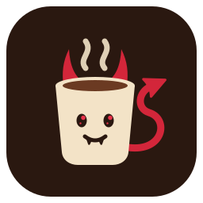

  

<h1 align="center">caffiend</h1>

Watches WooCommerce webshops (built for coffee roasters) and sends a message when a product is new,
and optionally when a sold-out one is back in stock. It reads each shop's public WooCommerce Store
API (`/wp-json/wc/store/v1/products`, on by default in WooCommerce), remembers what it has seen,
and notifies on the difference. The first run of a shop only remembers, so it never announces the
whole catalogue.

A message names the shop and the product, then shows the product's attributes you chose (origin,
process, tasting notes, whatever the shop provides), its price and the link:

    New at DAK: Juice Box
    Origin: Colombia
    Process: Washed
    Tasting notes: Blood Orange, Honey, Rhubarb
    20.95 EUR
    https://www.dakcoffeeroasters.com/product/juice-box/

## Configuration

One JSON file lists the shops and where messages go. Secrets are paths to files holding them,
never the secret itself.

    {
      "interval_secs": 600,
      "state_dir": "/var/lib/caffiend",
      "telegram": { "token_file": "/run/secrets/telegram-token", "chat_id": "123456789" },
      "ntfy": { "server": "https://ntfy.sh", "topic_file": "/run/secrets/ntfy-topic" },
      "shops": {
        "dak": {
          "url": "https://www.dakcoffeeroasters.com",
          "name": "DAK",
          "categories": ["filter", "espresso"],
          "attributes": ["Origin", "Process", "Tasting notes"],
          "restocks": false
        },
        "another": { "url": "https://shop.example.com" }
      }
    }

- **shops:** the key (`a-z`, `0-9`, `-`, `_`) names the shop's state file and appears in logs. Only
  `url` is required.
- **name:** what messages call the shop; defaults to its hostname.
- **categories:** only products in these category slugs; empty or absent means every product.
- **attributes:** which attributes to show, in this order, by the shop's own names (case does not
  matter); empty or absent means all of them. To see a shop's names, look at
  `<shop>/wp-json/wc/store/v1/products?per_page=1` under `attributes`.
- **restocks:** also announce sold-out products coming back. Off by default.
- **telegram:** a bot token from @BotFather and your user id (press Start on the bot first). The
  chat id is not a secret, the token is.
- **ntfy:** on a public server the topic is the only secret, so make it long and random.
- With no notifier configured it only logs what it would send.

Product attributes, prices and stock come from the shop; a shop that turns the Store API off
cannot be watched.

## Run it

    caffiend --config config.json              # polls every interval until stopped
    caffiend --config config.json --once       # polls every shop once and exits
    caffiend --config config.json --send-test  # sends one test message and exits

One shop being down or failing does not stop the others; it is logged and retried next interval.
A new way to reach a phone (Signal through signal-cli, say) is a new variant of `Notifier` in
`src/notify.rs`.

Development: `nix-shell`, then `cargo test` and `cargo clippy --all-targets -- -D warnings`.

## NixOS

The repository is a plain (non-flake) Nix project. Pin it, import the module, enable the service;
the module writes the configuration file above from `services.caffiend`.

    # npins add github olistrik caffiend
    let
      caffiend = import sources.caffiend { inherit (sources) nixpkgs; };
    in
    {
      imports = [ caffiend.nixosModules.default ];

      services.caffiend = {
        enable = true;
        telegram = {
          enable = true;
          tokenFile = "/run/secrets/caffiend-telegram-token"; # any secret manager; not the Nix store
          chatId = "123456789";
        };
        shops.dak = {
          url = "https://www.dakcoffeeroasters.com";
          name = "DAK";
          categories = [ "filter" "espresso" ];
          attributes = [ "Origin" "Process" "Tasting notes" ];
          # restocks = true;
        };
        # interval = 600;   # seconds between polls
      };
    }

The token file must be readable by the `caffiend` user (or whatever `user` is set to). For ntfy,
use `services.caffiend.ntfy = { enable = true; topicFile = ...; }` instead, or as well.

State lives in `services.caffiend.dataDir` (`/var/lib/caffiend`). Keep it across reboots: without
it, every restart is a silent first run and misses whatever appeared while the service was down.
On a setup that wipes the root filesystem on boot, add the directory to your persistence list.
